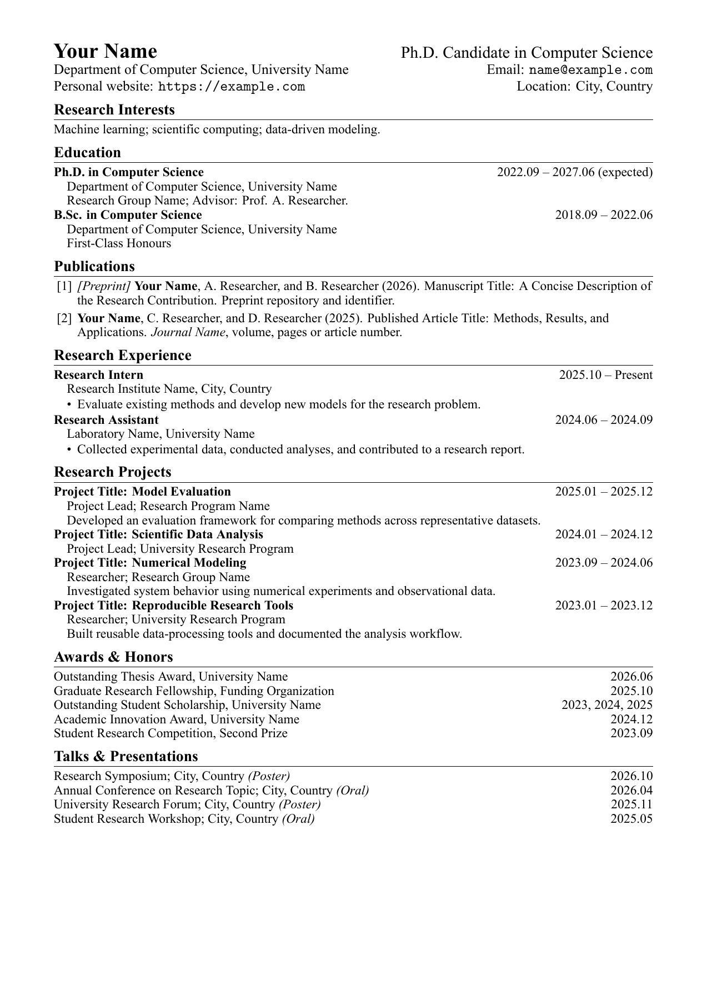

# Academic CV Template

**English** | [简体中文](README.zh-CN.md)

A compact academic CV in LaTeX with **Times New Roman**, a black-and-white layout, and ordinary paragraphs you can copy and edit directly. There is no custom class or entry framework. The example fits on one A4 page; your CV can grow to multiple pages.

All names, institutions, publications, and achievements in the example are fictional placeholders.



[View the example PDF](output/pdf/cv-template.pdf)

## Quick start

1. Download or clone this repository.
2. Install a TeX distribution such as TeX Live, MacTeX, or MiKTeX, including XeLaTeX and `latexmk`.
3. Make sure Times New Roman and its bold, italic, and bold italic faces are installed.
4. From the repository root, run:

```sh
latexmk cv-template.tex
```

The result is `output/pdf/cv-template.pdf`. The included `.latexmkrc` selects **XeLaTeX**; pdfLaTeX cannot load this template's system fonts through `fontspec`.

Without `latexmk`, run XeLaTeX directly:

```sh
mkdir -p output/pdf
xelatex -interaction=nonstopmode -halt-on-error -output-directory=output/pdf cv-template.tex
xelatex -interaction=nonstopmode -halt-on-error -output-directory=output/pdf cv-template.tex
```

## Edit your CV

Edit `cv-template.tex` directly. The example contains research interests, education, publications, research experience, research projects, awards, and presentations. Copy, remove, or reorder sections as needed.

Email and website values are defined once near the top:

```latex
\newcommand{\email}{name@example.com}
\newcommand{\website}{https://example.com}
```

Changing these definitions updates both the displayed text and clickable links. Include `https://` in the website value. Update the name, position, affiliation, and location in the header, and `pdftitle` / `pdfauthor` in `\hypersetup`. These PDF metadata fields do not control the output filename.

Use native LaTeX for entries:

```latex
\textbf{Degree or position}\hfill 2025.09 -- Present\par
\hspace*{1em}Institution or details\par
```

- `\section*{Heading}` adds a section.
- `\hfill` pushes dates to the right; `\par` ends a paragraph.
- `\hspace*{1em}` indents a detail line.
- `itemize` lists describe responsibilities; `enumerate` lists number publications.
- Dates with a known month use `yyyy.mm`; entries with only a known year keep the year.

Keep research descriptions concise. Use present tense for ongoing work and past tense for completed experience. Replace all example citations with verified titles, authors, publication status, and bibliographic details. Add actual DOI or paper links with `\href{URL}{text}`.

Escape LaTeX special characters in body text, for example `\&`, `\%`, and `\_`.

## Adjust spacing and typography

The shared gap is defined before `\begin{document}`:

```latex
\newcommand{\addspace}{\vspace{2pt}}
```

Insert `\addspace` wherever you want that gap. Change `2pt` once to adjust every use.

Section spacing is configured with:

```latex
\titlespacing*{\section}{0pt}{6pt}{4pt}
```

The three lengths are left indentation, space before the title, and space after it. Font sizes use `\fontsize{size}{baseline spacing}\selectfont`.

| Element | Font size / baseline spacing |
| --- | --- |
| Name | 18 pt / 21 pt |
| Position | 14 pt / 21 pt |
| Affiliation and contact lines | 12 pt / 13 pt |
| Section titles | 13 pt / 14 pt |
| Body | 11 pt / 12 pt |

A4 margins are 16 mm on the left and right and 13 mm at the top and bottom. Email and website addresses use Latin Modern Mono; the main text uses Times New Roman. Review line wrapping and page breaks after changing content. There is no enforced page limit.

## VS Code / LaTeX Workshop

Open the repository folder in VS Code. The included workspace settings select **latexmk (xelatex)** and use `output/pdf/`. Run **LaTeX Workshop: Build LaTeX project**.

If choosing a recipe manually, select **latexmk (xelatex)**. The extension's plain **latexmk** recipe passes `-pdf`, which overrides `.latexmkrc` and selects pdfLaTeX. After a failed build, run **LaTeX Workshop: Clean up auxiliary files**, then build with XeLaTeX again.

## PNG preview and optional Makefile

`latexmk` updates the PDF; it does not update the PNG. With Poppler's `pdftoppm` available, refresh the first-page preview manually:

```sh
pdftoppm -scale-to 1800 -png -singlefile output/pdf/cv-template.pdf output/pdf/cv-template
```

If `make` is available, these shortcuts are provided:

```sh
make pdf       # Compile the PDF.
make preview   # Compile and refresh the first-page PNG.
make clean     # Remove LaTeX intermediates; keep the PDF and PNG.
```

The Makefile is optional. If you rename the source, use `make pdf CV_SOURCE=YourName.tex` or `latexmk YourName.tex`. Output filenames follow the source basename.

## Fonts and Overleaf

Font files are not included. The default configuration requires **Times New Roman** and does not silently substitute another font. Latin Modern Mono is loaded from the TeX distribution's `lmmono10-regular.otf` file.

For Overleaf, select **XeLaTeX** as the compiler. If Times New Roman is unavailable, upload font files you are licensed to use to a `fonts/` folder and replace the `\setmainfont` block with their filenames, for example:

```latex
\setmainfont{times.ttf}[
  Path=fonts/,
  BoldFont=timesbd.ttf,
  ItalicFont=timesi.ttf,
  BoldItalicFont=timesbi.ttf
]
```

Use the actual filenames you upload. The local `fonts/` folder is ignored by Git.

## Repository contents

- `cv-template.tex`: editable source.
- `output/pdf/cv-template.pdf`: compiled example.
- `output/pdf/cv-template.png`: first-page preview used above.
- `.latexmkrc`: XeLaTeX build settings.
- `.vscode/settings.json`: LaTeX Workshop settings.
- `Makefile`: optional PDF, preview, and clean commands.
- `LICENSE`: MIT license.

## License

[MIT](LICENSE). Font files are not distributed with the repository and remain subject to their own licenses.
