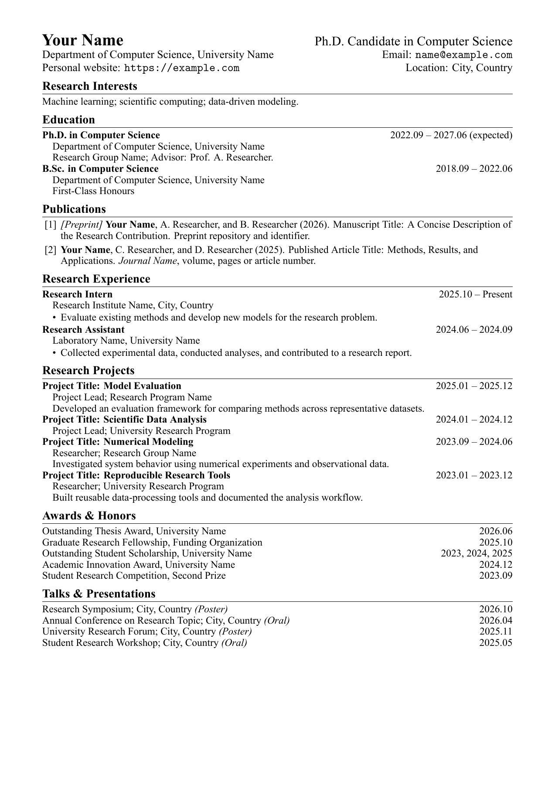

# 学术 CV 模板

[English](README.md) | **简体中文**

一个紧凑的 LaTeX 学术 CV 模板，采用 **Times New Roman** 和黑白排版，内容直接写在普通段落中，方便复制修改。不使用自定义文档类或条目框架。示例为 A4 单页，个人 CV 可以按需要扩展为多页。

示例中的姓名、学校、论文和经历均为虚构占位内容。



[查看示例 PDF](output/pdf/cv-template.pdf)

## 快速开始

1. 下载或克隆本仓库。
2. 安装 TeX Live、MacTeX 或 MiKTeX 等 TeX 发行版，确保包含 XeLaTeX 和 `latexmk`。
3. 安装 Times New Roman 及其粗体、斜体和粗斜体字体。
4. 在仓库根目录执行：

```sh
latexmk cv-template.tex
```

生成文件为 `output/pdf/cv-template.pdf`。附带的 `.latexmkrc` 默认使用 **XeLaTeX**；pdfLaTeX 无法通过 `fontspec` 加载本模板使用的系统字体。

没有 `latexmk` 时，可以直接运行 XeLaTeX：

```sh
mkdir -p output/pdf
xelatex -interaction=nonstopmode -halt-on-error -output-directory=output/pdf cv-template.tex
xelatex -interaction=nonstopmode -halt-on-error -output-directory=output/pdf cv-template.tex
```

## 修改内容

直接编辑 `cv-template.tex`。示例包含研究兴趣、教育、论文、研究经历、科研项目、奖项和学术报告，可自由复制、删除或调整分区顺序。

邮箱和网址在源码开头各定义一次：

```latex
\newcommand{\email}{name@example.com}
\newcommand{\website}{https://example.com}
```

修改定义后，显示文字和可点击链接会同步更新。网址请保留 `https://`。姓名、职位、所属机构和所在地直接在页首修改；同时更新 `\hypersetup` 中的 `pdftitle` 和 `pdfauthor`。这两个 PDF 元数据字段不控制输出文件名。

条目使用普通 LaTeX 写法：

```latex
\textbf{Degree or position}\hfill 2025.09 -- Present\par
\hspace*{1em}Institution or details\par
```

- `\section*{标题}` 添加分区。
- `\hfill` 将日期推到右侧，`\par` 结束段落。
- `\hspace*{1em}` 缩进详情行。
- `itemize` 列表描述工作内容，`enumerate` 列表为论文编号。
- 已知月份的日期统一使用 `yyyy.mm`；只有年份的条目保留年份。

研究工作描述保持简洁：正在进行的工作用现在时，已完成的经历用过去时。将所有论文示例替换为真实题名、作者、发表状态和引文信息，并用 `\href{链接}{文字}` 添加实际 DOI 或论文链接。

LaTeX 正文中的特殊字符需要转义，例如 `\&`、`\%` 和 `\_`。

## 调整间距与字号

统一间距命令在 `\begin{document}` 前定义：

```latex
\newcommand{\addspace}{\vspace{2pt}}
```

在需要留白的位置插入 `\addspace`；以后只需修改定义中的 `2pt`，即可统一调整这些间距。

分区标题间距由以下命令控制：

```latex
\titlespacing*{\section}{0pt}{6pt}{4pt}
```

三个长度依次是左侧缩进、标题前间距、标题后间距。字号使用 `\fontsize{字号}{基线间距}\selectfont` 设置。

| 元素 | 字号 / 基线间距 |
| --- | --- |
| 姓名 | 18 pt / 21 pt |
| 职位 | 14 pt / 21 pt |
| 所属机构与联系方式 | 12 pt / 13 pt |
| 分区标题 | 13 pt / 14 pt |
| 正文 | 11 pt / 12 pt |

A4 纸张左右页边距为 16 mm、上下为 13 mm。邮箱与网址使用 Latin Modern Mono 等宽字体，正文使用 Times New Roman。修改内容后请检查换行和分页，模板不强制限制页数。

## VS Code / LaTeX Workshop

在 VS Code 中打开仓库文件夹。附带的工作区设置默认选择 **latexmk (xelatex)** 配方，输出到 `output/pdf/`。运行 **LaTeX Workshop: Build LaTeX project** 即可编译。

手动选择配方时，请使用 **latexmk (xelatex)**。普通 **latexmk** 配方会传入 `-pdf`，覆盖 `.latexmkrc` 并改用 pdfLaTeX。编译失败后，可以运行 **LaTeX Workshop: Clean up auxiliary files**，再用 XeLaTeX 重新编译。

## PNG 预览与可选 Makefile

`latexmk` 会更新 PDF，但不会更新 PNG。安装 Poppler 并确保可以运行 `pdftoppm` 后，手动刷新第一页预览：

```sh
pdftoppm -scale-to 1800 -png -singlefile output/pdf/cv-template.pdf output/pdf/cv-template
```

如果已安装 `make`，也可以使用以下快捷命令：

```sh
make pdf       # 编译 PDF。
make preview   # 编译并刷新第一页 PNG。
make clean     # 删除 LaTeX 中间文件，保留 PDF 和 PNG。
```

Makefile 为可选工具。重命名源码后，可运行 `make pdf CV_SOURCE=YourName.tex` 或 `latexmk YourName.tex`；输出文件名跟随源码文件名。

## 字体与 Overleaf

仓库不包含字体文件。默认配置需要 **Times New Roman**，不会自动替换为其他字体。Latin Modern Mono 从 TeX 发行版中的 `lmmono10-regular.otf` 加载。

在 Overleaf 中选择 **XeLaTeX** 编译器。如果环境缺少 Times New Roman，可以将有合法使用权的字体文件上传到 `fonts/`，然后把 `\setmainfont` 配置改为对应文件名，例如：

```latex
\setmainfont{times.ttf}[
  Path=fonts/,
  BoldFont=timesbd.ttf,
  ItalicFont=timesi.ttf,
  BoldItalicFont=timesbi.ttf
]
```

请使用实际上传的文件名。本地 `fonts/` 文件夹已加入 Git 忽略规则。

## 仓库文件

- `cv-template.tex`：可编辑源码。
- `output/pdf/cv-template.pdf`：编译完成的示例。
- `output/pdf/cv-template.png`：上方使用的第一页预览。
- `.latexmkrc`：XeLaTeX 编译设置。
- `.vscode/settings.json`：LaTeX Workshop 设置。
- `Makefile`：可选的 PDF、预览和清理命令。
- `LICENSE`：MIT 许可证。

## 许可证

[MIT](LICENSE)。仓库不分发字体文件，字体仍适用各自的许可证。
